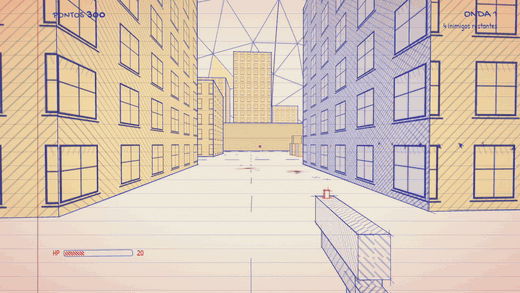

# Rabisco City, etapa 2: Traço de caneta



**O que entra nesta etapa:** texturas de hachura desenhadas em canvas e o contorno que "ferve".

Esta branch é um passo do jogo [Rabisco City](https://rabisco-city.vercel.app), construído em etapas. Cada etapa roda sozinha.

## Como rodar

Entre na pasta do projeto e suba um servidor de arquivos na porta **3333** (a mesma em todas as etapas):

```bash
npx serve -l 3333 .
# ou, se você tem Python:
python -m http.server 3333
```

Abra **http://localhost:3333**. Precisa de teclado e mouse.

## O que olhar no código

Nenhuma imagem é carregada: as hachuras são desenhadas num `canvas` e viram textura. O contorno é uma segunda geometria, só de linhas, que treme um pouco a cada quadro.

O `js/game.js` é dividido em seções marcadas com `// ---------- nome ----------`.

## O que mudou desde a etapa anterior

```bash
git diff etapa-01-a-folha etapa-02-traco-de-caneta
```

## Etapas

Anterior: `etapa-01-a-folha` · Próxima: `etapa-03-a-cidade`

```bash
git checkout etapa-03-a-cidade
```

A lista completa das etapas está no README da branch `etapa-09-placar` e da `main`.
